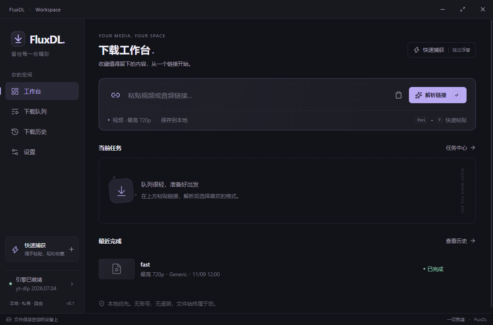

# FluxDL

一个本地优先、Windows-first 的 yt-dlp 桌面客户端。React + TypeScript + Vite / Tauri 2 + Rust，Midnight Glass 深石墨与银紫界面。无账号、无服务器、无遥测。



## 开始使用

**此版是外部引擎版，不附带 yt-dlp、FFmpeg 或 JS 运行时。** 安装/运行 FluxDL 后，打开「设置 → 引擎」，检测 PATH，或通过原生文件选择器指定自己已有的 `yt-dlp.exe`。此电脑在开发时找到了 `E:\VedioDownload\yt-dlp.exe`，这是本次验证使用的路径，程序没有把它硬编码为默认值。

FFmpeg 与 FFprobe 可从 PATH 检测，也可选择 `ffmpeg.exe` 或其所在目录。MP3 提取及分离音视频合并都需要这两个工具；没有时会提前阻止所需流程，允许确有音视频的直接格式降级下载。所有第三方引擎均由用户自行配置，FluxDL 不会自动下载或更新它们。

1. 在工作台粘贴 HTTP/HTTPS 单媒体链接，按 Enter 或「解析链接」。
2. 在右侧抽屉选视频/仅音频、画质、真实可用格式和保存目录，加入队列。
3. 查看实时进度、速度和 ETA；支持真正取消与主动重试。
4. 已完成任务可打开文件/目录、复制来源链接；删除历史记录只删除数据库记录。
5. 「快速捕获」打开另一个原生窗口，和工作台共用 Rust 任务源。Esc 收起窗口不会停止下载。

关闭工作台时，若有活动任务，应用提供「在后台继续 / 停止任务并退出 / 取消」；无任务时遵循设置里的关闭行为。托盘可重新打开两种窗口或真正退出。仅关闭快速捕获始终表示隐藏。真正退出会等待后台下载进程树停止。

## 本地开发与构建

本次在 Windows 11 x64、Node 24.16.0 / npm 12.0.1、Rust 1.97.0 MSVC、Visual Studio C++ 工具链和 Edge WebView2 上验证。依赖精确版本在两份 lockfile 中。推荐使用 npm，以本仓库的 `package-lock.json` 为准。

```powershell
cd 'E:\Software Development\FluxDL'
npm ci
npm run desktop:dev
```

浏览器界面预览：`npm run dev`，访问 `http://127.0.0.1:1420`。浏览器会明确提示仅预览，真实引擎、下载和系统操作需要桌面应用；没有内置演示任务。

```powershell
npm run typecheck
npm test
npm run check:rust
npm run test:rust
.\scripts\test-queue.ps1
npm run build
python scripts/collect-licenses.py
npm run desktop:build
npm run release:stage
```

`desktop:build` 使用 Tauri 2 构建 Windows x64 NSIS 安装包，输出为 `src-tauri/target/release/bundle/nsis/FluxDL_0.2.0_x64-setup.exe`，程序为 `src-tauri/target/release/fluxdl.exe`。`release:stage` 将安装包、程序、许可证和 SHA-256 校验值整理到项目根目录的 `release/`。本轮保留用户正在运行的0.1发行文件，不执行该复制步骤；新产物保留在target中。构建工具首次可能下载 NSIS/WebView2 官方打包资源；安装器仅在缺少 WebView2 时提供微软运行时引导安装，这与下载媒体引擎是两件事。版本未签名；这不是内置全依赖的绿色单文件版。

CI 配置在 `.github/workflows/windows.yml`，在 push、pull request 或手动运行时执行类型、lint、格式、Clippy、前端/Rust 测试、真实 worker fixture 和 NSIS 构建，上传安装包。本轮0.2工程优化按任务要求保留本地修改、不commit/push，没有触发或声称远程CI通过。

本地检查：`npm run typecheck`、`npm run lint`、`npm run format:check`、`npm test`、`npm run build`；Rust：`npm run format:rust`、`npm run lint:rust`、`npm run test:rust`，以及`.\scripts\test-queue.ps1`。`npm run test:styles`复现12项固定浏览器CSS等值检查。三档性能基准与实际结果见[工程基线](docs/engineering/0.2.0-performance-baseline.md)、[复测](docs/engineering/0.2.0-performance-after.md)和[验证报告](docs/engineering/0.2.0-validation-report.md)。

## 可重跑的真实联调

公开测试源使用 Blender Foundation 的 Big Buck Bunny 预告片（CC BY 3.0，详见第三方声明）；测试文件不会进入安装包。下面命令使用真实本机引擎及同一个生产队列管理器，验证解析、真实进度、串行任务、文件落地和重启持久化：

```powershell
cargo run --manifest-path src-tauri/Cargo.toml --example engine_smoke -- 'E:\VedioDownload\yt-dlp.exe' 'https://download.blender.org/peach/trailer/trailer_400p.ogg' 'E:\Software Development\FluxDL\artifacts'
```

完整桌面烟雾测试使用本地 FFmpeg 生成的原创测试图与正弦音轨、真实 yt-dlp 和实际 WebView2，不 Mock IPC 或下载。先确保 FFmpeg 在 PATH；脚本使用隔离debug数据和WebView profile，可与已有发行版共存，不应停止用户正在运行的实例：

```powershell
npx tauri build --debug --no-bundle
node scripts/desktop-smoke.mjs 'E:\VedioDownload\yt-dlp.exe'
```

它在 `artifacts/e2e-data/` 和 `artifacts/e2e-downloads/` 创建独立数据目录，测试两窗口、取消、错误重试、主题同步、历史、实际重启及强制结束后中断状态。**该测试会强制终止它自己创建的应用进程树以模拟异常退出**。仅当 debug 构建显式设置 `FLUXDL_TEST_DATA_DIR` 时启用本地诊断端口并跳过单实例重定向；release 中没有此入口。可选旧库seed、真实MP3和错误协议检查见工程验证报告；原生目录取消/托盘菜单补充工具及能力边界见[原生验证](docs/engineering/native-smoke.md)。

`scripts/test-queue.ps1` 编译源码中的确定性假引擎，只用于测试，覆盖串行、等待/运行取消、错误重试和安全退出。默认 `cargo test` 中该项被标为 ignored，需脚本显式运行。它不替代真实媒体联调。

## 数据、隐私与安全

- Rust 管理 SQLite，位置为系统 AppData 下 `io.fluxdl.desktop/fluxdl.sqlite3`（Windows 通常在 `%APPDATA%`）。任务来源链接和保存位置只在本机保存，不上传。分享诊断前仍应自行检查内容。
- 引擎日志移除URL凭据/query、Cookie及认证Header等敏感值，最多100行，每行1600字符；两路输出持续消费，单行内存有上限。
- 普通进度约4Hz增量推送、约2秒合并保存；创建、取消、重试、完成等关键变化在SQLite确认后公开。两个窗口按session/revision校验事件，缺口由完整快照恢复；低频checkpoint可发现丢失的最后终态。没有随机进度或前端定时伪造。
- SQLite采用独立连接线程和按记录增量事务，主任务锁不等待SQL。v1旧库事务升级，未知字段/不可理解行保留并诊断；未来或不兼容schema拒绝，只有确认物理损坏才先备份后重建。重启将所有可理解非终态任务（含等待中）标为「已中断」，由用户主动重试；写入未确认不会假报完成。
- URL、预设、格式和目录均在 Rust 再次校验；使用可执行文件加参数数组，不拼接 shell。加入队列会再次解析，防止前端伪造格式元数据。
- Windows 下载与解析子进程使用受控进程生命周期；取消下载会终止整个 Windows Job。Linux/macOS 没有做完整验收，子进程树保证仅针对 Windows。
- 两窗口只获得事件、拖动和原生文件选择权限；前端没有通用 shell 或文件系统接口。文件打开仅对已完成记录、安全目录内存在的媒体文件执行。
- 缩略图请求来自媒体来源，可能向该站点暴露网络请求；加载失败有占位。无远程字体。

## 故障排除与边界

| 情况 | 处理 |
|---|---|
| 找不到 yt-dlp | 设置里重新检测或选择真实 `.exe`；不要选择 Python 包或快捷方式。 |
| 自定义引擎无效 | 诊断显示当前失败路径与原因；清空路径再检测 PATH。指定无效自定义配置不会被悄悄忽略。 |
| 缺少 FFmpeg/FFprobe | 配置同一套工具的 bin 目录，重新检测；纯直连音视频可以降级。 |
| JS runtime/EJS 警告 | 可检测 Deno/Node 的路径与版本，但 EJS 只能通过实际站点输出观察；版本检测不代表所有站点可用。查看设置中的官方 EJS 帮助。 |
| TLS/网络/站点拒绝 | 检查网络与本机引擎版本，按需重试；软件不会自动抓浏览器 Cookies 或绕过登录。 |
| 默认画质找不到格式 | 已知分辨率按预设上限；未知分辨率允许直接下载，不承诺达到预设画质。 |
| 磁盘空间或写权限失败 | 更换目录并重试；只在退出码成功且真实最终文件存在后标记完成。 |
| 文件已被移动 | 历史显示本地文件不存在，打开按钮不可用，可仅删除记录。 |
| 重启看到已中断 | 点击重试；不会自动恢复，可能复用 yt-dlp 的 `.part` 片段，不能承诺断点续传。 |

本版不支持整播放列表批量下载、暂停、Cookies/代理配置、DRM/付费访问控制绕过、内置引擎自动安装/更新和全依赖便携单文件。视频优先兼容 MP4，源格式或编解码器不兼容时可能输出其他容器；不强制进行耗时视频转码。Windows 多屏与高DPI按逻辑尺寸与当前显示器边界处理；125%/150%系统缩放的真实显示器交互仍需人工复核。

只下载自己拥有权利或获得授权的内容，并遵守来源网站条款。

## 文件索引

- `src/App.tsx` / `windows/` / `pages/` / `features/`：薄入口、窗口、页面及业务组件。
- `src/lib/api.ts` / `types.ts` / `errors.ts`：集中IPC、类型与兼容错误；`stores/`：规范化缓存、selector、协议与恢复控制器。
- `src/styles/app.css`：按原层叠顺序组织Token、主题及窗口/业务样式。
- `src-tauri/src/lib.rs` / `commands.rs` / `windows.rs`：装配、受控命令、真实双窗口、托盘与退出。
- `src-tauri/src/engine/` / `process/`：引擎探测/解析/参数/进度与真实子进程所有权。
- `src-tauri/src/manager.rs` / `transitions.rs` / `events.rs`：队列协调、合法状态转换、有序增量事件。
- `src-tauri/src/persistence/` / `errors.rs` / `diagnostics.rs`：增量SQLite、稳定错误与日志脱敏。
- `src-tauri/tauri.conf.json` / `capabilities/desktop.json`：安装包、安全策略与权限。
- `docs/engine.md` / `docs/engineering/0.2.0-architecture.md` / `0.2.0-validation-report.md`：引擎、架构和本轮实际验证；`docs/validation.md`保留0.1历史。
- `LICENSE` / `THIRD_PARTY_NOTICES.md` / `licenses/`：MIT 项目许可、第三方声明与原文。

工程仓库：[DewMysimple/FluxDL](https://github.com/DewMysimple/FluxDL)。工程记忆使用 standard 模式，入口是 [wiki_memory/README.md](wiki_memory/README.md)，协作与持续提交推送规则见 [AGENTS.md](AGENTS.md)。

后续方向：独立引擎更新流程、可配置快捷键、播放列表设计、签名发布。本轮不创建远程Release、不触发CI；0.2产物在上述target目录，release/保留用户原0.1运行文件。后续CI产物可通过Actions获取，以实际运行结果为准。
